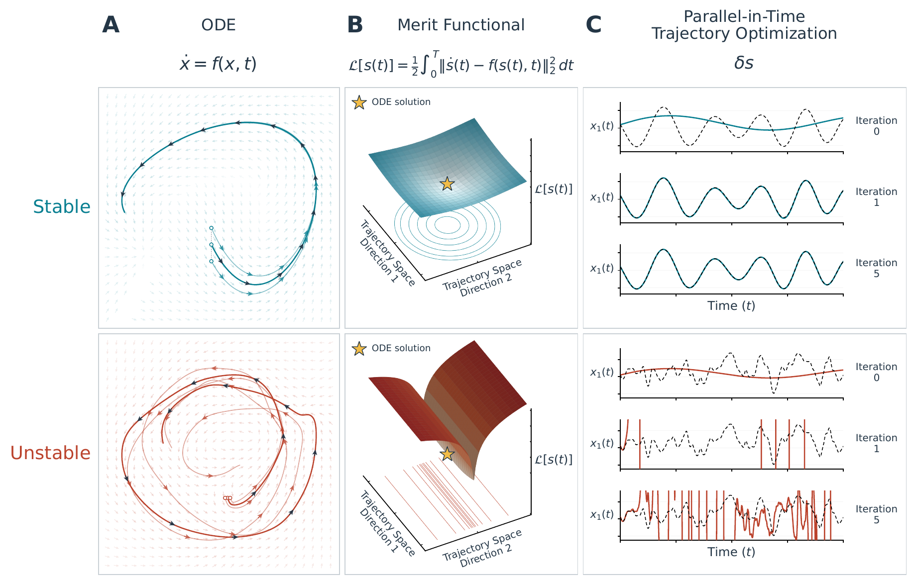
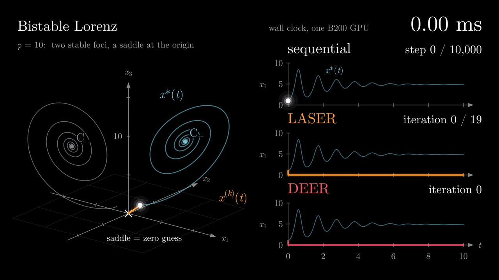
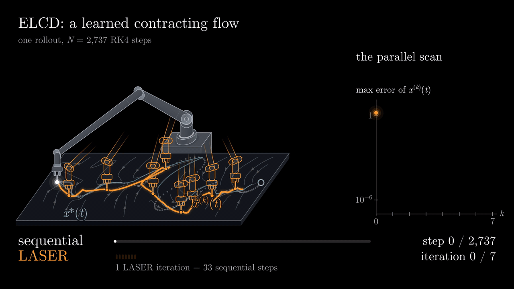

# Time Parallelization for Nonlinear ODEs

Code and Lean proofs for the paper

> **Towards a Modern Theory of Time Parallelization for Nonlinear ODEs**<br>
> Zhouyang Lu, Arvind R. Venkatakrishnan, Emmie Fitz-Gibbon, Xavier Gonzalez, Yu Kawano, Ian R. Manchester,
> Eduardo D. Sontag, Jean-Jacques Slotine, Francesco Bullo, Leo Kozachkov

An ODE is usually solved one time step after another. It can also be solved for all time steps at once, as an
optimization problem over whole trajectories, which a GPU handles in parallel. The paper shows when this is easy:
**the stability of the ODE sets the conditioning of that optimization problem.**

<p align="center"></p>

A stable system (top) gives a well-conditioned problem, and Newton's method over the whole trajectory converges in
a few iterations. An unstable system (bottom) gives an ill-conditioned one, and the same iteration blows up.

## What it looks like

**Bistable Lorenz.** From a guess that sits on the saddle point at the origin, plain Newton (DEER) blows up at its
second iteration.
LASER, the damped Newton method of the paper, converges in 19 iterations, about 10x faster than the sequential
solver (10,000 steps of dt = 0.001, one NVIDIA B200). More in [`experiments/lorenz/`](experiments/lorenz/).

<p align="center"></p>

**Robot motion with a contracting model (ELCD).** A training rollout of 2,737 steps is solved in 7 parallel
iterations. Over a whole training run this is about 35x faster than sequential rollouts. More in
[`experiments/elcd/`](experiments/elcd/).

<p align="center"></p>

## Install

Python 3.10.

```sh
python -m venv .venv && source .venv/bin/activate
pip install -c requirements-lock.txt -e ".[experiments,test]"
pip install "jax[cuda12]==0.6.2"        # only on a machine with an NVIDIA GPU
```

`pip install -e .` alone installs just the solver library, `parode`, with JAX and NumPy.

## Quick start

```sh
python quickstart.py
```

solves the bistable Lorenz problem (1000 Euler steps) with DEER and with LASER, in seconds on a CPU:

```
DEER  iterations   2   last update nan   max |parallel - sequential| nan
LASER iterations  22   residual 5.51e-15   max |parallel - sequential| 4.69e-13
```

[`quickstart.ipynb`](quickstart.ipynb) is the notebook version, with pictures: the run of the animation above,
LASER's iterates on their way from the saddle to the solution, and the damping it chooses at each iteration.

## Solve your own ODE

```python
import jax
import jax.numpy as jnp
from parode import LaserConfig, explicit_par_integrate, seq_integrate

jax.config.update("jax_enable_x64", True)

def f(t, x):                                   # a damped pendulum
    return jnp.array([x[1], -jnp.sin(x[0]) - 0.5 * x[1]])

x0, dt, N = jnp.array([2.0, 0.0]), 0.01, 2000
guess = jnp.zeros((N, 2))                      # a guess of the N states after x0

solve = jax.jit(lambda x0, guess: explicit_par_integrate(
    f, x0, guess, dt, 200, "rk4", tol=1e-9, laser=LaserConfig()))      # 200 is the cap on the iterations
sol, residual, iterations = solve(x0, guess)   # sol has shape (N + 1, 2)

print(iterations, residual, jnp.abs(sol - seq_integrate(f, x0, dt, N, "rk4")).max())
```

It converges in 4 iterations and agrees with the sequential solution to 3e-8.

- `f` is `f(t, x)`, or `f(t, x, u)` with `input_fn=` for a time-varying input.
- `laser=LaserConfig()` is LASER as the paper runs it. Without `laser=` the call is plain DEER.
- A solve that stops above `tol` does not raise, so look at `residual`. In float32 use a `tol` of 1e-5 to 1e-6.
- `implicit_solve` is the same solve with gradients, for training through it.

[`examples/own_ode.py`](examples/own_ode.py) is a longer template (batches with `jax.vmap`, the iteration history,
gradients), and [`docs/solvers.md`](docs/solvers.md) describes every argument.

## Repository layout

```
parode/                  the solver library: DEER, LASER, ELK, quasi-DEER, the implicit adjoint
quickstart.py            DEER and LASER on the bistable Lorenz system
quickstart.ipynb         the same as a notebook, with pictures
examples/own_ode.py      a template for an ODE of your own
experiments/
  lorenz/                bistable Lorenz from a guess on the saddle
  elcd/                  training contracting models of robot motion on long rollouts
  fig1/                  the paper's first figure
  appendix/              the experiments of the paper's appendix:
    gpu_scaling/         Jacobi and DEER on six GPU types, Jacobi on up to 8 GPUs
    contracting_ssm/     a contracting state-space model on EigenWorms
    robot_control/       neural and adaptive controllers of a two-link arm
    euler_step_size/     the forward-Euler step-size example
results/  figs/          the recorded results and the paper's figures as this code draws them
lean/                    Lean proofs of Theorems 1 and 2
tests/                   the test suite
docs/                    solver reference and reproduction guide
```

## Reproducing the paper

```sh
make smoke      # every experiment at small scale on a CPU, about 5 minutes
make figures    # redraws the figures from the recorded results, about 2 minutes
make test       # the test suite, 20 to 28 minutes on four cores
```

Each experiment folder has a short README with its own commands;
[`experiments/appendix/`](experiments/appendix/) lists the appendix experiments. The training runs need GPUs (ELCD alone about
1,200 GPU hours), so their results are recorded in `results/`.
[`docs/reproducing.md`](docs/reproducing.md) maps every figure and table of the paper to a command.

## Lean proofs

[`lean/ModernODE-Lean-ode/`](lean/ModernODE-Lean-ode/README.md) proves the paper's two main bounds, Theorems 1
and 2, in Lean 4.

```sh
cd lean/ModernODE-Lean-ode
lake exe cache get      # mathlib's compiled cache, about 5.5 GB
./verify.sh             # builds the proofs and audits their axioms, about 15 minutes in total
```

## Acknowledgments

`parode` started from [parallel-ode](https://github.com/casiacob/parallel-ode) by Casian Iacob, the code of
Iacob, Razavi and Särkkä, *A parallel-in-time Newton's method-based ODE solver* (arXiv:2511.01465). We thank its
author. Other files are ports of ELCD, ELK, dynamax, DEER and others, listed with their licences in
[`THIRD_PARTY_NOTICES.md`](THIRD_PARTY_NOTICES.md).

## License and citation

BSD 3-Clause, see [`LICENSE`](LICENSE).

```bibtex
@misc{lu2026towards,
  title  = {Towards a Modern Theory of Time Parallelization for Nonlinear ODEs},
  author = {Lu, Zhouyang and Venkatakrishnan, Arvind R. and Fitz-Gibbon, Emmie and Gonzalez, Xavier and
            Kawano, Yu and Manchester, Ian R. and Sontag, Eduardo D. and Slotine, Jean-Jacques and
            Bullo, Francesco and Kozachkov, Leo},
  year   = {2026},
  note   = {Preprint}
}
```
