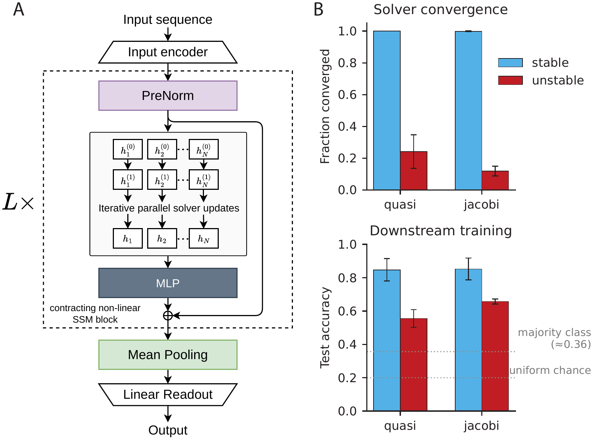

# A contracting state-space model trains in parallel

A state-space model is a recurrent network whose hidden state follows an ODE. Here each layer's ODE has a leak term
-gamma h with gamma >= gamma_min. The leak makes the ODE contracting: any two trajectories approach each other. We
train a classifier on EigenWorms (worm-movement recordings of 17,984 steps, 5 classes) and solve each layer's ODE in
three ways: one Euler step after another, or for all steps at once by Jacobi iterations (recompute every step from
the previous guess until nothing changes) or by quasi-DEER (Newton's method with a diagonal Jacobian). All three
reach about 85 % test accuracy, and quasi-DEER makes a training epoch 89 to 121 times faster than the sequential
solve.

<p align="center"></p>

**A**: the model. An input encoder is followed by L blocks. Each block solves the ODE of a contracting cell with a
parallel solver, for the whole sequence at once, and passes the result through an MLP. Mean pooling and a linear
readout give the class.

**B**: blue ("stable") is the contracting model at gamma_min = 0.05, red ("unstable") the same model without the
leak term. With the leak, both parallel solvers converge on practically every solve (top) and the model reaches
85 % (bottom). Without it, quasi-DEER and Jacobi converge on only 24 % and 12 % of the solves, and accuracy falls
to 56 % and 66 %.

A larger gamma_min contracts faster, and Jacobi gains the most from it:

| gamma_min | test accuracy | quasi-DEER speedup | Jacobi speedup |
|---|---|---|---|
| 0.01 | 84.8 % | 91x | 4.2x |
| 0.02 | 85.4 % | 89x | 5.9x |
| 0.05 | 85.0 % | 108x | 12.2x |
| 0.10 | 84.8 % | 121x | 22.3x |
| 0.20 | 83.1 % | 117x | 36.0x |

Speedup is the sequential time per epoch over the parallel one. Mean of 5 seeds, one NVIDIA B200 per run.

## Try it

From the repository root, get the data and PyTorch to read it, then train each solver for two epochs on every 64th
time step:

```sh
bash experiments/appendix/contracting_ssm/download_data.sh                           # 107 MB, into data/eigenworms
pip install torch==2.8.0 --index-url https://download.pytorch.org/whl/cpu
export JAX_PLATFORMS=cpu
for s in seq quasi jacobi; do
    python experiments/appendix/contracting_ssm/run_train.py --solver $s --gamma_min 0.05 --decimate_stride 64 --epochs 2
done
```

Each run takes about 30 s. The three solvers print the same losses and accuracies; two short epochs
reach a test accuracy of only 0.386. The `iters=` field (quartiles and maximum) shows that a solve takes 5 to 7
quasi-DEER iterations or about 40 to 100 Jacobi sweeps.

## Redraw the figures

```sh
python experiments/appendix/contracting_ssm/table_gamma_min.py     # the table above
python experiments/appendix/contracting_ssm/figure_ablation.py     # the bars of panel B, into figs/contracting_ssm/
```

Both read `results/contracting_ssm/runs.csv`, the results of the paper's 79 training runs.

## Rerun the experiment

Fill in `YOUR_ACCOUNT` and `YOUR_GPU_PARTITION` in `slurm/train.slurm` first. The 79 runs took 29.8 GPU hours.

```sh
mkdir -p logs
bash experiments/appendix/contracting_ssm/slurm/submit_gamma_min_sweep.sh     # the 75 runs of the table
bash experiments/appendix/contracting_ssm/slurm/submit_ablation.sh            # the 4 runs without the leak term
```

## Files

```
run_train.py                        one training run; its defaults are the paper's settings
training.py                         the training loop
cell_solvers.py                     the three solvers and their shared backward pass
stacked_model.py                    the classifier around the cell
eigenworms_data.py                  loads the data; download_data.sh fetches it
table_gamma_min.py                  the table above
figure_ablation.py                  panel B of the figure above
slurm/                              the GPU jobs
../shared/contracting_ssm_cell.py   the cell and its ODE
```

[DETAILS.md](DETAILS.md) has every command, the result file and where each number of the paper comes from.
