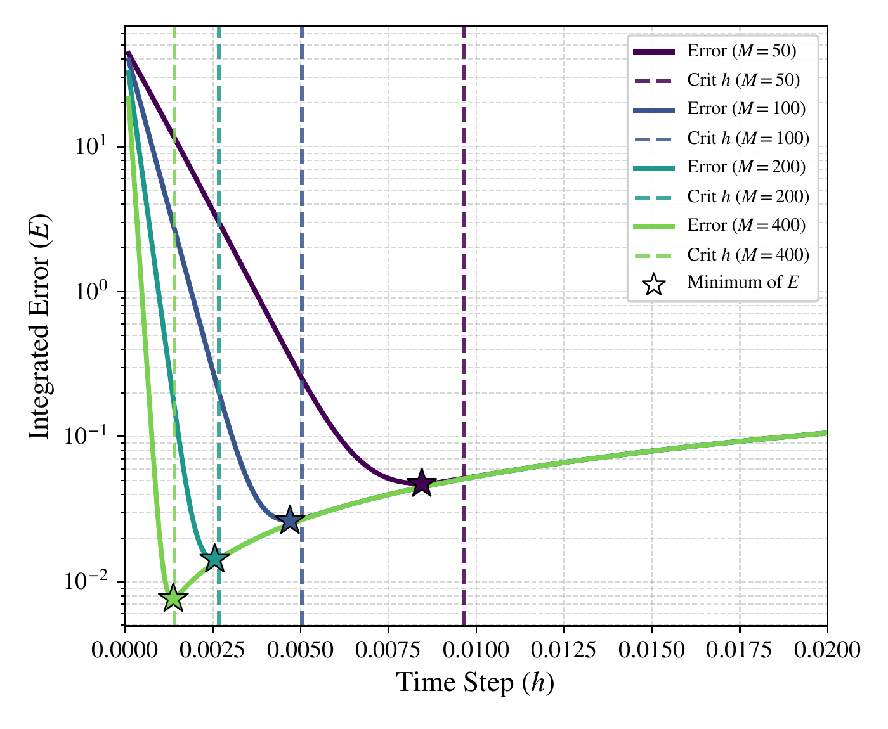

# Euler step size: with a fixed number of parallel sweeps, smaller is not better

We solve x' = -20 x + 20 sin(2t), x(0) = 10, on [0, 5] by forward Euler, in parallel with M Jacobi sweeps. A
sweep applies the Euler update at every time step at once, from the previous sweep's values; the first sweep
starts from the constant guess x = 10. With M fixed, the error is smallest at an intermediate step size. The
paper's appendix estimates this best step size; the estimate lands 3 to 14 % too large.

<p align="center"></p>

- **Curves:** the error E (the area between the computed and the exact solution) against the step size h.
- **Left of the stars:** the steps are small, and M sweeps cover too short a time to wash out the initial guess.
- **Right of the stars:** forward Euler's own error takes over, and all curves merge into it.
- **Dashed lines** ("Crit h"): the estimate. The error there is at most 9 % above the star's.

## Run it

From the repository root, on a CPU:

```sh
python experiments/appendix/euler_step_size/figure_step_size.py        # NumPy and Matplotlib only, about 30 s
JAX_PLATFORMS=cpu python -m pytest -q tests/test_euler_step_size.py    # 6 tests, about 30 s
```

The script prints the appendix's numbers next to their recomputed values and draws the figure into
`figs/euler_step_size/`.

## Files

```
figure_step_size.py       the whole experiment: the curves, the estimate, the printout, the figure
paper_figure_marks.json   points read from the paper's figure; the tests check the script against them
```

[DETAILS.md](DETAILS.md) has the formulas of the estimate and the full printout.
