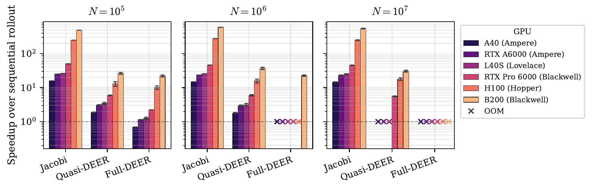

# GPU scaling: plain Jacobi wins on a contractive RNN

An RNN x_{n+1} = W tanh(x_n) + c_n, with a 64-dimensional state and random inputs c_n, is rolled out for N steps,
up to N = 10^7. Every singular value of W is 0.6, so the RNN is contractive. We time three parallel solvers against
the sequential rollout (one step after another) on six GPU types. The simplest solver, the Jacobi iteration, wins:
on one NVIDIA B200 it is 548x faster than the sequential rollout at N = 10^7.

<p align="center"></p>

- **Jacobi** recomputes all N states at once from the previous guess. Because the RNN is contractive, each
  iteration multiplies the error by at most 0.6, so about 22 cheap iterations suffice at every N.
- **Full-DEER** is Newton's method over the whole trajectory. It needs 6 iterations, but each one stores and
  multiplies a 64 x 64 Jacobian per step: slow, and out of memory at long N (the crosses).
- **Quasi-DEER** keeps only an estimate of the Jacobian's diagonal. It needs 86 to 106 iterations and fits at
  N = 10^7 on three of the six GPUs.

With 2, 4 or 8 B200s, each GPU takes one block of the N steps. This pays off only for long rollouts:

| Jacobi, speedup | N = 10^5 | N = 10^6 | N = 10^7 |
|---|---|---|---|
| 1 B200 | 493x | 591x | 548x |
| 2 B200 | 419x | 1,004x | 1,058x |
| 4 B200 | 342x | 1,429x | 2,053x |
| 8 B200 | 168x | 1,458x | 3,209x |

Mean of five random RNNs, against the sequential rollout on one B200.

## Try it

From the repository root, on a CPU:

```sh
JAX_PLATFORMS=cpu python experiments/appendix/gpu_scaling/run_single_gpu.py --max-T=10000 --n-repeats=1 \
    --algorithms=jacobi_scan,quasi_deer,full_deer
```

It takes under a minute and prints one row per solver and N (`T` in the code). The iteration counts do not grow
with N: 22 for Jacobi, 86 for quasi-DEER, 6 for Full-DEER. On a CPU every speedup is below 1; the parallel solvers
need a GPU.

## Redraw the figure and the table

```sh
python experiments/appendix/gpu_scaling/figure_single_gpu.py     # the figure above, into figs/gpu_scaling/
python experiments/appendix/gpu_scaling/table_multi_gpu.py       # prints the table above
```

They read the recorded results in `results/gpu_scaling/`.

## Rerun the experiment

```sh
mkdir -p logs
for g in a40 a6000 l40s rtx_pro_blackwell h100 b200; do    # one job per GPU type
  sbatch --constraint=$g experiments/appendix/gpu_scaling/slurm/run_single_gpu.slurm $g    # --constraint: your site's GPU name
done
for n in 2 4 8; do
  sbatch --constraint=b200 --gres=gpu:$n experiments/appendix/gpu_scaling/slurm/run_multi_gpu.slurm $n
done
```

Fill in your account and GPU partition in the two templates first. The single-GPU jobs take about 16 GPU hours in
all, each multi-GPU job 16 to 20 minutes.

## Files

```
contractive_rnn.py      the RNN: W, the inputs and the step map
jacobi_scan.py          the sequential rollout and the Jacobi iteration
solvers.py              the solvers, each timed against the sequential rollout
run_single_gpu.py       the sweep over N on one GPU
jacobi_multi_gpu.py     Jacobi with the time axis split over several GPUs
run_multi_gpu.py        the sweep on several GPUs
speedups.py             the speedups from the result files
figure_single_gpu.py    the figure above
table_multi_gpu.py      the table above
slurm/                  the GPU jobs
```

[DETAILS.md](DETAILS.md) has every command, the result files and how each speedup is computed.
