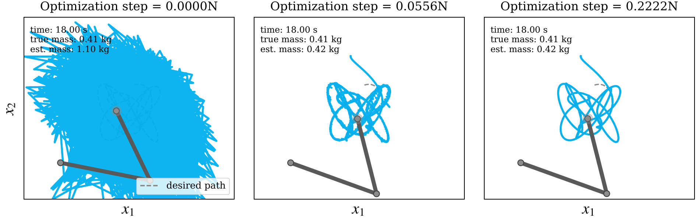

# Robot control: a two-link arm solved in parallel over time

Two experiments on a controlled two-link robot arm. Stabilizing feedback is what lets us solve the closed-loop
motion for all time steps at once.

1. **Neural controllers** ([`neural/`](neural/)) are trained through a parallel Newton solve of the closed loop.
   A training step is 14 to 74 times faster than with a sequential solver.
2. **An adaptive controller** ([`adaptive/`](adaptive/)), which estimates an unknown payload mass, is simulated
   by Jacobi sweeps. About 1800 sweeps reproduce the sequential rollout of 9000 time steps.

## 1. Neural controllers, trained through a parallel solve

The controllers add a learned torque to a PD controller. Two are MLPs; the third is a contracting SSM, a recurrent
state-space model whose trajectories converge to each other. Every training step solves the closed loop (1000
time steps) by Newton's method, on an exponential-integrator (DEER-exp) or an explicit-Euler (Euler-DEER)
discretization.

| controller | parameters | tracking error (RMSE) | speedup, DEER-exp | speedup, Euler-DEER |
|---|---|---|---|---|
| PD only | | 0.584 | | |
| MLP large | 17.9k | 0.096 | 67x | 14x |
| MLP small | 2.7k | 0.117 | 74x | 20x |
| contracting SSM | 2.3k | 0.108 | 50x | 28x |

Speedups are measured on one NVIDIA B200. Each entry is the mean over the seeds whose training stayed finite: all
five for the contracting SSM, four for MLP large, two for MLP small. At the end of training the SSM needs 6 or 7
Newton iterations per solve, the MLPs 9 to 32.

**Try it** on a CPU, from the repository root. This trains MLP small for two steps with each solver, in about a
minute:

```sh
JAX_PLATFORMS=cpu python experiments/appendix/robot_control/neural/run_controller_table.py --seeds 0 --epochs 2 \
    --timing-runs 1 --archs mlp_small --out results/robot_control/check/mlp_small.json
```

**Print the table** from the recorded results in `results/robot_control/`:

```sh
python experiments/appendix/robot_control/neural/table_controllers.py
```

**Rerun the training.** Fill in `YOUR_ACCOUNT` and `YOUR_GPU_PARTITION` in the job template first. Each job takes
up to 70 min on one NVIDIA B200.

```sh
mkdir -p logs
S=experiments/appendix/robot_control/neural/slurm/run_controller_table.slurm
sbatch $S 0 results/robot_control/check/bench_table.json
sbatch $S 1,2,3,4 results/robot_control/check/bench_table_seeds1-4_kp3.json
python experiments/appendix/robot_control/neural/table_controllers.py results/robot_control/check     # after both jobs
```

## 2. An adaptive controller, simulated by Jacobi sweeps

A Slotine-Li adaptive controller steers the arm along a path while it estimates the mass of a payload that changes
in time. We find all 9000 states of the closed loop at once by Jacobi sweeps: a sweep applies one Euler step to
every time point. The first guess is the reference path plus noise.

<p align="center"></p>

The end-effector path (blue) after 0, 500 and 2000 sweeps, which the panel titles write as optimization steps
0, 0.056 N and 0.22 N. Each sweep makes one more step exact, so N sweeps always reproduce the sequential rollout;
here 0.2 N (1827) already agree with it to 10^-6.

**Try it** on a CPU. This runs all 9000 sweeps in under a minute and prints the distance to the sequential
rollout, which falls below 10^-6 at sweep 1827:

```sh
JAX_PLATFORMS=cpu python experiments/appendix/robot_control/adaptive/run_slotine_li.py --out results/robot_control/check
```

**Redraw the figure** from the recorded results, into `figs/robot_control/`:

```sh
python experiments/appendix/robot_control/adaptive/figure_slotine_li.py
```

## Files

```
neural/
  run_controller_table.py   trains the neural controllers and times a training step
  table_controllers.py      prints the table from the recorded results
  implicit_deer.py          DEER-exp and Euler-DEER, with gradients through the solve
  sequential_solvers.py     the sequential solvers that the speedups compare against
  ssm_policy.py             the contracting SSM controller
  arms.py                   the arm
  controller_utils.py       the MLP and the reference trajectory
  slurm/                    the GPU job of the training runs
adaptive/
  run_slotine_li.py         the rollout by Jacobi sweeps
  figure_slotine_li.py      the figure above
```

[DETAILS.md](DETAILS.md) has the settings, every command and where each number of the paper comes from.
