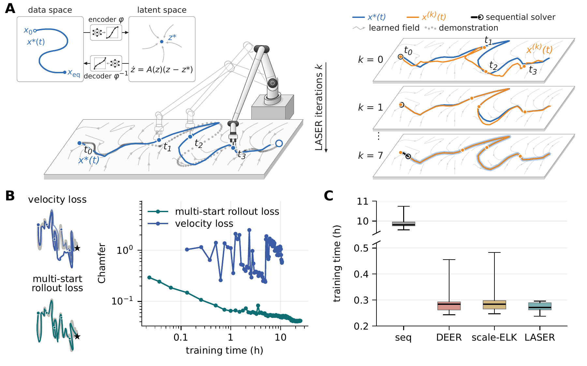

# ELCD: parallel-in-time rollouts make training on long motions 35x faster

ELCD (Jaffe et al., NeurIPS 2024) is a learned model of robot motion that is contracting by construction: all its
trajectories converge to the goal. We train it with a multi-start rollout loss: at every training step, 192
rollouts start at recorded states and are compared with the demonstrations. Solving all time steps of each rollout
at once, with plain Newton (DEER) or LASER, the paper's damped Newton method, instead of one after another, makes
training on `chain8z` (panel C) about 35x faster in float32.

<p align="center"></p>

- **A.** An encoder maps the state to a latent space, where a contracting vector field pulls every trajectory to
  the equilibrium z*. A decoder maps latent states back to the data space. On the right, LASER solves one rollout
  of 2,737 time steps in 7 iterations. In that time, the sequential solver (black ring) reaches time step 232.
- **B.** The rollout loss fits the long demonstration. The velocity loss of Jaffe et al., which only matches the
  recorded velocities, does not. The Chamfer distance measures the gap between the two curves.
- **C.** Time of 10,000 training steps on `chain8z`, eight handwriting shapes chained into demonstrations of
  7,689 samples (float32, ten seeds, one NVIDIA B200). Sequential rollouts take 9.6 to 10.7 h, parallel ones 0.24
  to 0.48 h. The median speedup is 34.9x for DEER and 36.6x for LASER. scale-ELK damps the Newton step with a
  tuned constant. Over the ten seeds, DEER failed in 1,383 training steps, which the sequential solver redid;
  LASER never failed.

## Try it

From the repository root, on a CPU:

```sh
ELCD_NPEND_DIR=results/elcd/check/npend python -c \
    "from experiments.elcd.train.pendulum import generate_npend; print(generate_npend('2-N400-b2'))"
ELCD_NPEND_DIR=results/elcd/check/npend JAX_PLATFORMS=cpu python experiments/elcd/train/train_elcd.py \
    --system npend:2-N400-b2 --dtype fp64 --seed 0 --loss suffix --starts 64 --lr-schedule cosine \
    --steps 3 --solver laser --fallback seq --max-iter 0 --tol 1e-7 --out results/elcd/check/a/laser.json
```

The first command simulates a small two-link pendulum (400 samples), so nothing needs to be downloaded. The second
trains ELCD on it for three training steps with LASER and 64 rollouts from each of the three demonstrations, 192
per step as in the paper, in about two minutes. Each training step prints the loss and how many rollouts converged
(192 of 192, in at most 9 LASER iterations); then the model is evaluated.

## Redraw the figures and tables

`results/elcd/hours_table.csv` has the training hours, speedup and fallback steps of every run, the numbers of the
paper's tables.

```sh
bash experiments/elcd/download_data.sh   # the LASA data; about 4 minutes, as it also simulates the pendulum
mkdir -p results/elcd/check/figs
cp figs/elcd/appendix/seed_trajectories.pkl results/elcd/check/figs/
python -m experiments.elcd.figures.figure_appendix trajectories --cached --out results/elcd/check/figs
python experiments/elcd/schematic/make_schematic_C.py      # panel A, into results/elcd/check/figs/
```

They draw panel A and the appendix figure with the rollouts of the ten models trained with each loss. The rest of
the figure above reads the paper's run records, about 4.5 GB, which are not in the repository.

## Rerun the experiment

```sh
bash experiments/elcd/download_data.sh
mkdir -p logs
sbatch --array=1-20 --time=4-00:00:00 \
    --export=ALL,CELLS=experiments/elcd/configs/cells/main_chain8z.txt experiments/elcd/slurm/run_cell.slurm
```

Fill in the account and the partition in the template first. Each line of a run list is one GPU job: one task,
precision and seed, with the listed solvers. Submit `main_chain8z_laser.txt` (LASER) the same way, and
`main_chain8z_loop_s3-9.txt` (the rest of the sequential runs) with `--array=1-14`. The paper's runs
took about 1,200 GPU hours, most of them on NVIDIA B200.

## Files

```
model.py, flow_gatherfree.py   the ELCD model: the contracting latent field, the encoder and the decoder
train/train_elcd.py            the training driver: one model, one task, one loss, one solver
train/losses.py                the multi-start rollout loss and the velocity loss
train/run_cell.py              one line of a run list: every listed solver on one task, precision and seed
train/data.py                  the tasks: LASA shapes, chain8z, the pendulums
configs/cells/                 the run lists of the paper
slurm/                         the GPU jobs
figures/                       the figure and table builders
schematic/                     panel A of the figure
download_data.sh               the LASA handwriting data and the pendulum data
```

[DETAILS.md](DETAILS.md) has every file, the run lists, the result files and where each number of the paper comes
from.
