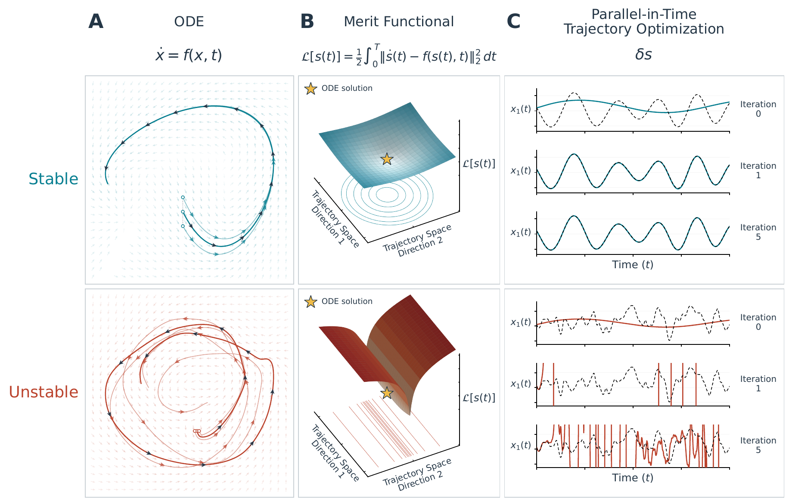

# Figure 1: stability sets the conditioning

The paper's first figure solves two 128-dimensional recurrent neural networks (RNNs), one stable and one chaotic
(the figure's Unstable row), for all time steps at once. For the stable RNN this is a well-conditioned problem, and
Newton's method converges in 4 iterations. For the chaotic one it is ill conditioned, and the first Newton step
lands 10^44 times farther from the solution than the initial guess.

<p align="center"></p>

- **A.** Three nearby trajectories on a two-dimensional projection of the vector field. They merge for the stable
  RNN and spread apart for the chaotic one.
- **B.** The merit functional (how far a trajectory is from solving the ODE) over a plane in trajectory space
  through the solution (star). Its curvatures along the two directions differ by a factor of 1.3 for the stable RNN
  and 5.4 million for the chaotic one. This ratio measures the conditioning.
- **C.** DEER iterates (colored) against the solution (dashed). DEER is Newton's method on all time steps at once.

## Try it

From the repository root, on a CPU:

```sh
mkdir -p results/fig1/check
python experiments/fig1/make_figure.py --output results/fig1/check                  # draws the figure from data/, seconds
python experiments/fig1/simulate_deer.py contracting --cache results/fig1/check     # minutes
```

The last command runs DEER on the stable RNN and prints its relative error after each iteration: 1, 3e-2,
6e-5, 2e-10 and 8e-16.

## Recompute the figure

```sh
python experiments/fig1/simulate_all.py --cache results/fig1/check                          # columns A and B, minutes
python experiments/fig1/simulate_deer.py chaotic --max-iter 230 --cache results/fig1/check  # hours
python experiments/fig1/make_figure.py --cache results/fig1/check --output results/fig1/check
```

Together with the stable run above, these commands recompute every array of the figure on one CPU core, with NumPy
and Matplotlib only.

## Files

```
make_figure.py          draws the figure; figure1_paper_figure.ipynb makes the same call
model.py                the two RNNs and their integrators
simulate_all.py         columns A and B, with simulate_geometry.py
simulate_deer.py        column C: DEER in NumPy
plot_*.py, style.py, export.py, svg_utils.py   drawing helpers
data/                   the arrays the figure reads
inputs/                 the two initial states
output/deer/            the figure as a PDF
```

[README.txt](README.txt) has the mathematical construction of each column and how every data file was made.
