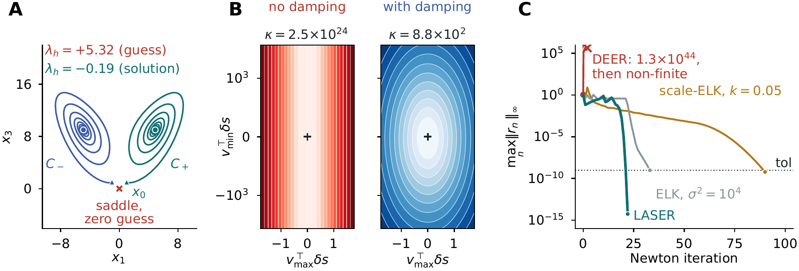

# Bistable Lorenz: a bad guess breaks plain Newton

The Lorenz system with rho = 10 has two stable equilibria and a saddle at the origin. We solve one trajectory for
all time steps at once, starting from the worst guess there is: the constant trajectory that sits on the saddle.

<p align="center"></p>

- **DEER** (plain Newton) diverges. After one step its residual is 10^44, then it is not finite.
- **scale-ELK** and **ELK** damp the Newton step with a constant. They converge once that constant is tuned for
  the horizon.
- **LASER** sets the damping at every iteration from how unstable the current guess is. It has nothing to tune,
  converges in about 20 iterations at every horizon and is the fastest solver, the sequential one included.

| | N = 10^3 steps | N = 10^4 | N = 10^5 |
|---|---|---|---|
| DEER | diverges | diverges | diverges |
| scale-ELK, tuned | 90 iterations, 9.3 ms | 227 iterations, 51.3 ms | 227 iterations, 179 ms |
| LASER | 22 iterations, 7.3 ms | 21 iterations, 12.6 ms | 21 iterations, 45.2 ms |
| sequential | 14.4 ms | 123 ms | 1,280 ms |

Explicit Euler, dt = 0.01, float64, tolerance 10^-9, one NVIDIA B200.

## Try it

From the repository root, on a CPU:

```sh
python quickstart.py        # DEER and LASER at N = 1000, a few seconds

JAX_PLATFORMS=cpu python experiments/lorenz/run_benchmark.py --dt 0.01 --dtype fp64 --tol 1e-9 --rho 10 \
    --N 1000 --max-iter 200 --methods deer,scale-elk:0.05,elk:30000,laser --outdir results/lorenz/check/cap200
```

The second command takes about ten seconds and prints one row per solver. The iteration counts must be 2
(then NaN) for `deer`, 90 for `scale-elk:0.05`, 27 for `elk:30000` and 22 for `laser`.

[`quickstart.ipynb`](../../quickstart.ipynb) at the repository root draws LASER's iterates and its damping, for
10,000 steps of dt = 0.001.

## Redraw the figures

```sh
ONLY=lorenz bash tools/run_figure_notebooks.slurm      # the figure above
python experiments/lorenz/figure_tuning.py             # appendix: the tuning sweep of scale-ELK and ELK
python experiments/lorenz/figure_residual.py           # appendix: residuals at the long horizons
```

They read the recorded results in `results/lorenz/` and write into `figs/lorenz/`. `make figures` at the
repository root runs all three.

## Rerun the experiment

```sh
JAX_PLATFORMS=cpu python experiments/lorenz/run_bistable_figure.py     # the numbers of the figure, 1 to 4 minutes
JAX_PLATFORMS=cpu python experiments/lorenz/run_spectra.py             # the Lyapunov exponents quoted in the paper
```

The iteration counts of the table come out the same on a CPU. Its times were measured on a GPU with the job
templates in `slurm/`.

## Files

```
run_benchmark.py            the benchmark: DEER, scale-ELK, ELK and LASER on the Lorenz problem
run_bistable_figure.py      the numbers of the figure above; figure_bistable.ipynb draws it
figure_tuning.py            the two appendix figures
figure_residual.py
run_seq_timing.py           the time of the sequential solver
run_residual_histories.py   the residual after every iteration
run_spectra.py              the Lyapunov exponents
slurm/                      the GPU jobs
```

[DETAILS.md](DETAILS.md) has every command, the result files and where each number of the paper comes from.
